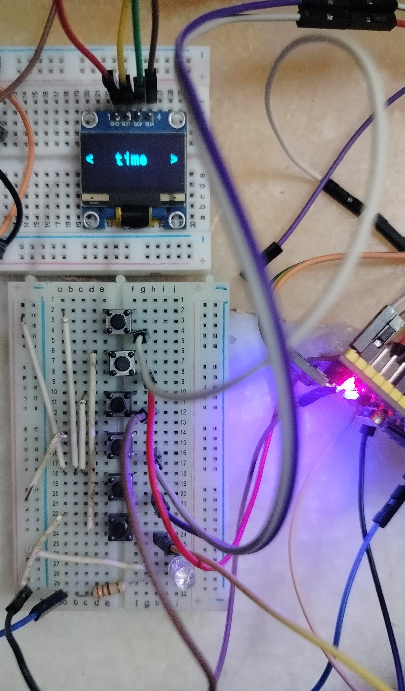

# HI, this project is a working clock, timer, and stopwatch using the STM32F103C8T6 (Blue Pill) module.
## Required products:
        6 buttons
        1 OLED 0.96-inch module
        1 STM32 Blue Pill
        Breadboard, jumper wires.
        
   

## Here are some important points about this 
        We used the buttons with the edge detection system for accurate detection.
        We used the button count increment method to use one button press in different inner loops.
        We used HAL_GETTICK(), which works based on the SysTick () timer with a free-running counter and no CPU blocking, instead of timers in the code, which will make the microcontroller work better than using timers and HAL_DELAY()
        For the timer and stopwatch, we used the % operator, which helps us set the range for a variable
        Buttons 4 and 5 increment and decrement until you release them. Button 6 starts the timer.
        Here in the timer, we used two variables: one stores the given timer in milliseconds, and another variable counts HAL_GETTICK() to get those increments milliseconds; when both match, then we get the red LED to blink and reset the timer
        We used the conversion of milliseconds to seconds, minutes, and hours in the stopwatch working.
        Button 4 is used to reset the stopwatch. Button 5 is used for lap purposes.
        HAL_GETTICK() always increments its value in milliseconds until the microcontroller powers off
## working 
.MP4)   

        
